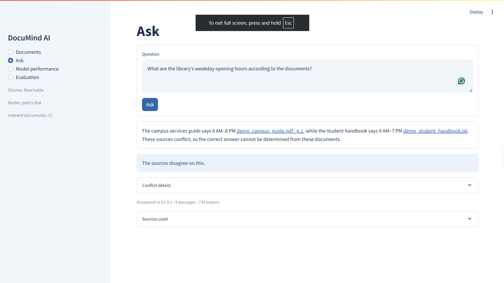
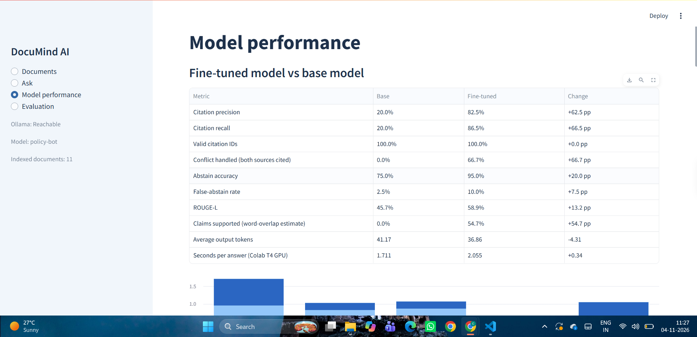
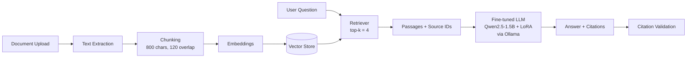

# DocuMind AI: Multi-Document RAG with Citations

> A local, privacy-friendly document Q&A app. Upload policy documents, ask questions, and get answers **with citations**, powered by a **LoRA fine-tuned Qwen2.5-1.5B-Instruct** model running through Ollama.


<!-- TODO: items marked TODO still need your real values. Delete this comment when done. -->

---

## 1. Overview

DocuMind answers questions over **multiple documents at once** (university rules, company policies, etc.) and points to the source of each claim.

**Problem it solves:** Policy documents are long and scattered across files. Plain LLMs hallucinate, and generic RAG apps often give answers without proof.

**What DocuMind does differently:**
- Answers only from the uploaded documents
- Attaches citations (document name and page) to every answer
- Detects **conflicting information** across documents and shows both sources
- **Abstains** ("not found in the documents") instead of guessing
- Ignores irrelevant distractor documents
- Uses a **locally fine-tuned model**, with no external API required

---

## 2. Demo

### Ask: conflicting sources are shown, not hidden
Two documents give different library hours. DocuMind cites both and says the sources disagree instead of picking one.



### Model performance: fine-tuned vs base model


<!-- TODO: add docs/screenshots/evaluation.png (Evaluation page) and docs/screenshots/documents.png (Documents page), then reference them here -->

---

## 3. Features

| Feature | Description |
|---|---|
| Multi-document upload | Upload several PDFs / text files and ask across all of them |
| Cited answers | Every answer links to its supporting document and page |
| Citation validation | Cited IDs are checked against the retrieved passages |
| Conflict handling | Shows both sources when documents disagree |
| Abstention | Says "not found" when the documents lack the answer |
| Unseen documents | Works on new documents uploaded at run time |
| Model performance page | Fine-tuned vs base model comparison, parameters and token sizes |
| Evaluation page | Runs benchmark questions through retrieval, generation and citation validation |

---

## 4. Architecture



**Pipeline:** extract text, split into chunks, embed, store, retrieve the top 4 chunks for a question, pass them with source labels to the model, return an answer that cites those sources, then validate the citations.

---

## 5. Tech Stack

| Layer | Technology |
|---|---|
| UI | Streamlit (pages: Documents, Ask, Model performance, Evaluation) |
| LLM runtime | Ollama (model name: `policy-bot`) |
| Base model | Qwen2.5-1.5B-Instruct (4-bit, Unsloth) |
| Fine-tuning | LoRA on Google Colab |
| Retrieval | `TODO` embedding model and vector store (e.g. FAISS / Chroma) |
| Language | Python 3.10+ |

---

## 6. Model Details

### Training and parameters

| Parameter | Value |
|---|---|
| Base model | Qwen2.5-1.5B-Instruct (4-bit, Unsloth) |
| Total parameters | 1.56 B |
| Trainable parameters | 18.46 M (1.18%) |
| Fine-tuning method | LoRA |
| LoRA rank / alpha | 16 / 32 |
| Training / validation examples | 224 / 26 |
| Epochs / steps | 3 / 84 |
| Learning rate | 0.0002 |
| Effective batch size | 8 |
| Training time | 3.7 min |
| Validation loss / perplexity | 0.777 / 2.17 |
| Exported model | Q4_K_M GGUF, `TODO` size |

### Token and context sizes

| Item | Value |
|---|---|
| Training average tokens | 398 |
| Training maximum tokens | 579 |
| Test average input tokens | 177 |
| Model context window | 32,768 |
| Ollama context (`num_ctx`) | 4,096 |
| Retrieval top-k | 4 |
| Chunk size | 800 characters |
| Chunk overlap | 120 characters |

### Dataset
Synthetic Q&A pairs built over university rules and company policies, covering four edge cases:
1. Multi-document synthesis
2. Conflicting information
3. Abstention / not found
4. Irrelevant distractor documents

Training data and test data were generated by **different sources**, so the test set does not copy the training style.

---

## 7. Evaluation

### 7.1 Fine-tuned model vs base model

Same test questions run on both models (inference on a Colab T4 GPU).

| Metric | Base | Fine-tuned | Change |
|---|---|---|---|
| Citation precision | 20.0% | 82.5% | +62.5 pp |
| Citation recall | 20.0% | 86.5% | +66.5 pp |
| Valid citation IDs | 100.0% | 100.0% | +0.0 pp |
| Conflict handled (both sources cited) | 0.0% | 66.7% | +66.7 pp |
| Abstain accuracy | 75.0% | 95.0% | +20.0 pp |
| False-abstain rate | 2.5% | 10.0% | +7.5 pp |
| ROUGE-L | 45.7% | 58.9% | +13.2 pp |
| Claims supported (word-overlap estimate) | 0.0% | 54.7% | +54.7 pp |
| Average output tokens | 41.17 | 36.86 | -4.31 |
| Seconds per answer (Colab T4) | 1.711 | 2.055 | +0.34 |

**Reading the results:** fine-tuning mainly teaches the model to **cite the right sources**, **show both sides of a conflict** and **refuse when the answer is missing**. The trade-off is a higher false-abstain rate (it sometimes refuses a question it could have answered) and slightly slower answers.

### 7.2 End-to-end evaluation (app pipeline)

Run from the **Evaluation** page: retrieval, answer generation and citation validation on the benchmark questions. Citation support is an automatic estimate.

| Metric | Result |
|---|---|
| Answer accuracy | 100% |
| Grounded answers | 86% (hallucination rate 14%) |
| Retrieval hit rate | 100% |
| Citation support | 86% |
| Conflicts handled | 100% |
| Correct refusals | 0% |

<!-- TODO: check "Correct refusals 0%". It disagrees with abstain accuracy 95% in 7.1. Likely the benchmark has no refusal questions or the metric is not computed. Fix the benchmark or explain it here before the jury. -->

Benchmark size: `TODO` questions.

---

## 8. Project Structure

`TODO`: replace with your actual folders (run `tree /F /A` in PowerShell, skipping `.venv*`).

```
GENAI JURY/
├── app.py                # Streamlit entry point
├── pages/                # Documents, Ask, Model performance, Evaluation
├── src/                  # chunking, retrieval, prompting, citation logic
├── data/                 # sample documents, train/test Q&A
├── notebooks/            # Colab LoRA fine-tuning notebook
├── docs/screenshots/     # images used in this README
├── requirements.txt
├── .gitignore
└── README.md
```

---

## 9. Installation (Windows)

### Prerequisites
- Python 3.10+
- [Ollama](https://ollama.com/download) installed and running
- Git

### Steps

```powershell
# 1. Clone
git clone https://github.com/chaitanya0313/DocuMind-Rag-System.git
cd DocuMind-Rag-System

# 2. Virtual environment
python -m venv .venv
Set-ExecutionPolicy -Scope Process -ExecutionPolicy RemoteSigned
.\.venv\Scripts\Activate.ps1

# 3. Dependencies
pip install -r requirements.txt

# 4. Load the fine-tuned model into Ollama
ollama create policy-bot -f Modelfile      # TODO: add Modelfile / GGUF download link

# 5. Run
streamlit run app.py
```

Open `http://localhost:8501` in your browser. The sidebar shows whether Ollama is reachable, the active model (`policy-bot`) and the number of indexed documents.

---

## 10. Usage

1. **Documents:** upload one or more files.
2. **Ask:** type a question and read the answer with its citations. Expand *Sources used* and *Conflict details* for evidence.
3. **Model performance:** view the fine-tuned vs base comparison.
4. **Evaluation:** run the benchmark and view parameters, token sizes and scores.

---

## 11. How It Works

### Ensuring citations support the answer
Retrieved passages are labelled with source IDs, the model is fine-tuned to cite those IDs, and a validation step checks that every cited ID exists in the retrieved passages (valid citation IDs: 100%). Citation precision and recall are measured against the expected sources.

`TODO`: add any extra check you implemented (for example, the word-overlap check for supported claims).

### Handling conflicting sources
When retrieved passages disagree, the model is trained to state each version with its own citation and say that the sources conflict, instead of choosing one silently. The app also shows a *Conflict details* panel.

### Abstention
When the retrieved context does not contain the answer, the model replies that the information was not found in the uploaded documents.

---

## 12. Limitations

- A 1.5B model can miss details on long or complex documents
- Fine-tuning raised the false-abstain rate (2.5% to 10.0%)
- Citation support is a word-overlap estimate, not a human judgement
- Answers can be slow on a laptop (the demo above took 61.9 s on a 16 GB RAM machine; Colab T4 takes about 2 s)
- Ollama context is limited to 4,096 tokens
- Scanned PDFs need OCR before they can be used
- Evaluation set is small (`TODO` size)

## 13. Future Work

- Larger base model or more training data
- Re-ranking of retrieved chunks
- OCR support for scanned PDFs
- Human-checked citation evaluation

---

## 14. Author

**Chaitanya Madan Pingle**
B.Tech CSE, MIT ADT University, Pune
GitHub: [chaitanya0313](https://github.com/chaitanya0313)

## 15. License

`TODO`: MIT License (or your choice)
